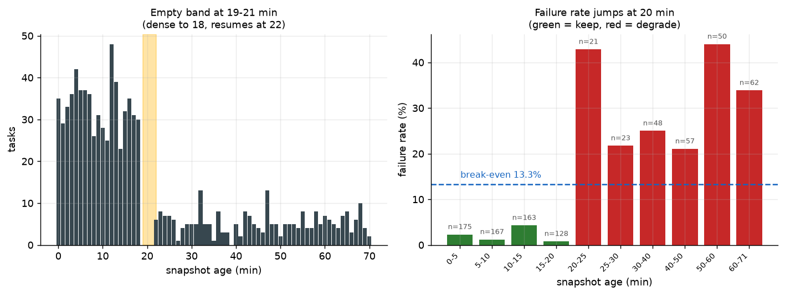
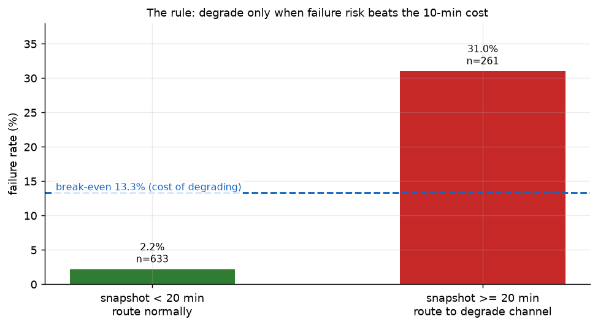
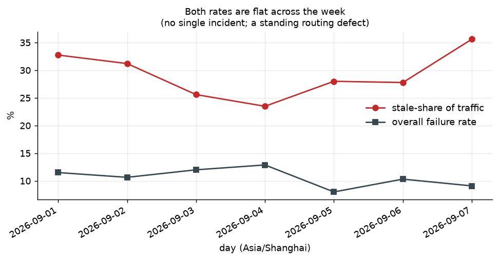

# 渲染任务失败率归因（render-failure-rca）

对 `render_tasks.csv`（981 行，2026-09-01 ~ 09-07）的完整分析。

**一句话结论：调度系统在「节点快照过期」的情况下仍然照常路由。快照年龄 ≥ 20 分钟的任务失败率 31.0%，< 20 分钟的只有 2.2%（相差 14 倍）；前者占全部失败任务的 85%。在路由前对快照年龄设一道闸门，即可消除约 85% 的失败。**

---

## 1. 我的判断

### 1.1 看到了什么

`cluster_synced_at`（调度系统最后一次同步该节点状态的时间）与 `created_at`（任务发起时间）之差，就是**路由时这份节点快照有多旧**。把它和 `is_success` 放在一起看，信号非常干净：

| 快照年龄 | 任务数 | 占比 | 失败数 | 失败率 |
|---|---|---|---|---|
| **< 20 分钟** | 633 | 70.8% | 14 | **2.2%** |
| **≥ 20 分钟** | 261 | 29.2% | 81 | **31.0%** |

- 相对风险 **14.0 倍**；Fisher 精确检验 p = 1.15e-33（比值比 0.05）。
- 过期的快照贡献了 **85%（81/95）** 的全部失败。
- 95% 置信区间：过期 25.7–36.9%，新鲜 1.3–3.7%，两者完全不重叠。



### 1.2 阈值 20 分钟不是拍的，是数据自己长出来的

快照年龄的直方图在 **19–21 分钟是空的**：

```
 0-18 分钟 : 633 个任务（密集）
19-21 分钟 :   0 个任务   <-- 空档
22+  分钟 : 261 个任务
```

健康的同步路径**从来不会**落到 19–21 分钟；退化的路径**从 22 分钟起步**。这不是一个缓慢漂移的过程（漂移会把 19–21 填满），而是两个离散状态之间的硬切换。健康态的最大年龄是 18 分钟，退化态的最小年龄是 22 分钟——**19 到 21 之间的任何阈值切分结果完全相同**，我取了中间的 20 分钟。

### 1.3 根问题

**调度器读的那一个字段（`free_slots`）对失败几乎没有解释力，而真正有解释力的字段（快照年龄）根本没有进入路由决策。**

- `AUC(free_slots) = 0.535` —— 接近抛硬币。
- `AUC(快照年龄) = 0.819`。
- `corr(快照年龄, free_slots) = -0.022` —— 两者独立。

过期快照行和新鲜快照行记录的 `free_slots` 均值分别是 14.55 和 14.85（Mann-Whitney p = 0.64），**没有差别**。也就是说：调度器在两种情况下都看到了一台「健康、有空闲通道」的节点。过期这件事，在它实际读取的字段里是**不可见**的。

根问题一句话：**路由决策建立在一份可能已经失效的节点状态快照上，而系统没有任何机制感知这份快照有多旧。**

### 1.4 一个必须讲清楚的反例：cluster_west

三个集群（east / north / south）在快照过期时失败率飙到 33.9% / 42.9% / 37.1%，**但 cluster_west 只有 1.9%（52 个过期任务里只失败 1 个）**。

| 集群 | 过期快照失败率 | 新鲜快照失败率 |
|---|---|---|
| cluster_east | 33.9% (21/62) | 0.0% |
| cluster_north | 42.9% (33/77) | 1.2% |
| cluster_south | 37.1% (26/70) | 3.1% |
| **cluster_west** | **1.9% (1/52)** | 4.3% |

West 的过期任务在**每一个我能观测到的字段上都和其他集群没有区别**（快照年龄 p=0.12、free_slots p=0.54、时长 p=0.39；任务类型分布 p=0.26、时长分布 p=0.37）。如果「快照旧」本身有害，west 也该受害。它没有。而且 west 的**新鲜**任务失败率（4.3%）反而比它的过期任务（1.9%）更高。

**所以年龄是相关指标，不是机理本身。** 真正有害的情形是「快照已经不再反映节点真实状态，而路由器还在信它」。我无法从这份数据里观测节点的真实容量，因此**无法完全区分**下面两种解释：

1. 过期数据导致错误路由，把任务发到了实际已满的节点；
2. 节点劣化时既停止上报、又渲染失败——过期只是同一个病因的**症状**。

两者都与上述全部证据相容。**但无论哪一种，运维动作是同一个**：不要在超过 20 分钟的快照上做路由决策。West 的价值在于，它让我们能**量化这条规则的误伤成本**——见 §4。

---

## 2. 做了什么

### 2.1 分析

| 步骤 | 内容 |
|---|---|
| 口径统一 | `created_at` 是 `+08:00`，`cluster_synced_at` 是 `Z`（UTC）。**先统一到 UTC 再相减**，否则年龄会整体偏移 8 小时。 |
| 数据清洗 | 剔除 47 组完全相同的重复行（见 §5.1）；`is_success` 为空的 40 行不参与失败率计算，但单独做了检验（§5.2）。 |
| 阈值发现 | 扫描 5–60 分钟全部阈值，用题目给的分钟成本建模，选出最优切点。19/20/21 三点的结果完全一致。 |
| 排除混淆 | 逐一检验 `free_slots`、`video_duration_sec`、集群、任务类型、时间趋势，确认都不是驱动因素。 |
| 稳健性 | 时间外验证（前 4 天训练 / 后 3 天测试）+ 留一集群交叉验证。 |
| 量化收益 | 用题目给定的 75 分钟超时成本、10 分钟降级成本算出净收益与盈亏平衡点。 |

### 2.2 建议的修复

**规则：路由前检查快照年龄。超过 20 分钟就不要用它做决策——先向节点重新查询；查不到就切到低开销降级通道。**

按成本口径（超时失败 75 分钟 / 次，降级 10 分钟 / 次）。**三个方案都以同一基线对比**：当前 95 次失败 × 75 = 7125 分钟/周的创作者等待。

| 方案 | 预期失败数 | 预期成本 | 净收益 |
|---|---|---|---|
| **A. 路由前刷新快照** | 19.8 | 1483 分钟 | **5642 分钟（94.0 小时）/周** |
| **B. 过期任务走降级通道** | 14 + 降级 261 次 | 3660 分钟 | **3465 分钟（57.8 小时）/周** |
| **B'. 同 B，但豁免 west** | 15 + 降级 209 次 | 3215 分钟 | **3910 分钟（65.2 小时）/周** |

- **优先做 A**：它比 B 多赚 **2177 分钟/周**，且几乎零成本——只是多一次同步查询。
- B 是 A 的兜底（节点查不通时的降级路径）。
- B' 的豁免依据只有 7 天窗口里的 52 行数据。**先上通用规则，等第二周复现了再加豁免。**

> **关于 A 的一个建模陷阱（已修正）：** 刷新快照后，这 261 个任务**不会变得不失败**，它们只是加入了「新鲜」人群，并按新鲜人群的失败率（2.21%）失败——预期 5.8 次失败。所以 A 的净收益是 5642 分钟，而不是「避免全部 81 次失败」的 6075 分钟。后者会高估 433 分钟。

**盈亏平衡点：** 降级只有在 `P(失败) > 10/75 = 13.3%` 时才划算。过期快照实测 31.0%，是盈亏平衡的 **2.3 倍**；新鲜快照 2.2%，低于盈亏平衡，**不该降级**。这条规则在数据两侧都是对的。



**敏感性：** B 的净收益 = `81 × F − 261 × D`（F 为单次失败成本，D 为单次降级成本）。只要 `D < 23.3 分钟`，方案 B 就仍然为正——也就是说，即使降级成本比题目给的 10 分钟**贵 2.3 倍**，这笔账依然划算。

### 2.3 上线清单

1. **路由闸门**：快照年龄 > 20 分钟 → 先重查节点，查不到则走降级通道。仅此一条即消除 85% 的失败。
2. **把快照年龄变成一等调度指标**，而不是调试字段。它是数据里最强的信号（AUC 0.82），而当前真正用于路由的字段几乎无用（AUC 0.54）。
3. **监控 19–21 分钟这个空档**。它一旦开始出现流量，说明同步路径正在向失败区漂移——这是一个**提前于失败率上升**的告警。
4. **`free_slots == 0` 作为弱信号**：25 个任务，失败率 36.0%（其余 9.9%）。比年龄弱，但免费。
5. **修数据管道**：47 个 task_id 被重复上报、40 行 `is_success` 为空，下次分析就不必再写免责声明。

---

## 3. 怎么证明有用

### 3.1 复现方式

```bash
pip install pandas numpy scipy matplotlib
python analysis/analyze.py
```

零参数。读取 `data/render_tasks.csv`，输出：

- `out/report.txt` —— 本次运行的完整文字记录（**README 里每一个数字都出自这里**）
- `out/findings.json` —— 同一批数字的结构化版本
- `out/fig1_lag_gap.png` ~ `fig4_timeline.png` —— 四张图

环境：Python 3，pandas / numpy / scipy / matplotlib。原始 CSV 原样放在 `data/`，未做任何手工修改。

### 3.2 关键数字（均由脚本算出）

```
总体失败率                        : 10.6% (95/894)
快照年龄 >= 20 分钟               : 261 个任务 (29.2%)  ->  81 失败 = 31.0%
快照年龄 <  20 分钟               : 633 个任务 (70.8%)  ->  14 失败 =  2.2%
相对风险                          : 14.0x
过期快照占全部失败的比例           : 85% (81/95)
Fisher 精确检验                   : p = 1.15e-33
AUC(快照年龄) / AUC(free_slots)   : 0.819 / 0.535
corr(快照年龄, free_slots)        : -0.022
盈亏平衡失败率                    : 13.3%  (实测 31.0%，2.3x 余量)
```

### 3.3 稳健性检验

**时间外验证**（前 4 天 / 后 3 天，切分点 09-05）：

```
train 09-01..09-04   过期 34.0% (n=144)   新鲜  3.0% (n=367)
test  09-05..09-07   过期 27.4% (n=117)   新鲜  1.1% (n=266)
```

**留一集群交叉验证**：

```
drop cluster_east    过期 30.2% (n=199)   新鲜 2.9% (n=486)
drop cluster_north   过期 26.1% (n=184)   新鲜 2.6% (n=468)
drop cluster_south   过期 28.8% (n=191)   新鲜 1.9% (n=474)
drop cluster_west    过期 38.3% (n=209)   新鲜 1.5% (n=471)
```

效应在时间维度和集群维度上都稳定。去掉 west（唯一的反例）后效应**更强**（38.3%），说明结论不是被某个集群拉动的。

**趋势检查**：7 天里失败率（8.0%–12.9%）和过期占比（23.5%–35.6%）都在窄区间内波动，没有单日事故。这是一条**长期存在的路由缺陷**，不是一次性故障。



---

## 4. west 反例让结论更强，而不是更弱

如果只看「过期 → 失败率 14 倍」，很容易得出一个过于自信的结论：*过期数据导致失败*。West 挡住了这条路。

West 在**同等过期程度**下（中位年龄 42 分钟，与其他集群的 48 分钟无显著差异，p=0.12）几乎不受影响。这意味着「年龄 ≥ 20 分钟」是一个**代理指标**，不是因果机制。诚实的表述是：

> 快照年龄是当前可观测的最强风险信号（AUC 0.82），但它衡量的很可能是「节点是否已经停止如实上报」这件事，而不是「数据旧」本身。

这个反例有实际价值：

1. **它给出了规则的误伤成本**：west 的 52 个过期任务本可以不降级。B' 方案把这部分省下来，多赚 370 分钟/周。
2. **它指出了下一步该采什么数据**：需要节点的**真实**并发占用（而不是上报值），以及同步 agent 的心跳/健康状态。有了这两个字段，才能把「数据旧」和「节点坏」彻底分开。
3. **它防止了过度拟合**：我不会建议「按年龄一刀切 + 永久豁免 west」——52 行样本撑不起一个集群级豁免。

---

## 5. 数据质量问题（都会影响结论可信度，故明确标出）

### 5.1 重复行：47 个 task_id 被完整重复了一次

94 行是完全相同的副本，涉及 47 个 task_id。它们**并非全部成功**（`is_success` 有 0 也有 1），所以不能简单理解为「重试记录」。分析中已去重。

- 去重前失败率 10.52%，去重后 10.63%——**对结论无实质影响**，但管道应当修。

### 5.2 `is_success` 为空的 40 行（4.1%）

- 这些行**并非集中在过期快照上**：其中 32.5% 是过期行，而整体过期占比 29.2%（Fisher p = 0.72）。
- **最坏情况**（假设这 40 行全部失败）：总体失败率从 10.6% 升到 14.5%，**结论不变**。
- 它们与重复 task_id 无交集。

### 5.3 未使用的数据

**没有引入任何外部或自造数据。** 全部数字来自 `data/render_tasks.csv`。成本参数（75 分钟 / 10 分钟）直接取自题目口径。

---

## 6. 仓库结构

```
render-failure-rca/
├── README.md                  # 本文
├── AI_LOG.md                  # AI 交互记录
├── data/
│   └── render_tasks.csv       # 原始数据（未修改）
├── analysis/
│   ├── analyze.py             # 唯一入口，一键复现全部结论
│   └── explore/               # 探索过程脚本，不参与交付结论
└── out/
    ├── report.txt             # 运行记录（README 数字来源）
    ├── findings.json          # 结构化结果
    └── fig1..fig4.png         # 四张图
```

`analysis/explore/_explore*.py` 是探索过程中的中间脚本，**不参与交付结论**，保留仅为过程透明。

---

## 7. 交付后改进记录

> 48 小时内可继续改进。以下按时间顺序追加。

**v1（首次提交）**
- 完成快照年龄归因、20 分钟阈值发现、混淆排除、稳健性检验与收益量化。
- 识别 cluster_west 反例，并将其作为**边界条件**而非噪声处理（§4）。
- 明确区分「数据过期导致错路由」与「节点劣化同时导致停报和失败」两种解释，并说明本数据集无法证伪其中任一种。
